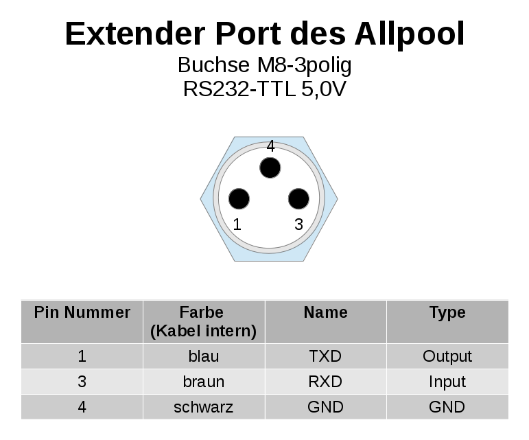
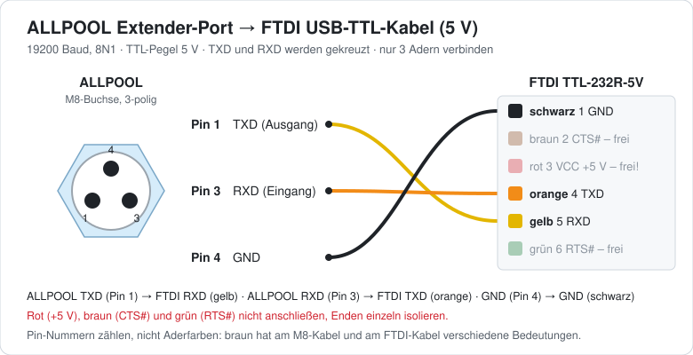

# AllPool-MQTT – PAUSCH ALLPOOL ↔ Home Assistant

[English](README.md) | **Deutsch**

Bridge für den Raspberry Pi: liest die ALLPOOL-Schwimmbadsteuerung über das
ASCII-Protokoll am Extender-Port (USB-Seriell, 19200 8N1) aus, schickt die Werte
per MQTT an Home Assistant und führt Befehle aus Home Assistant aus.
Home Assistant erkennt das Gerät automatisch (MQTT-Discovery), du musst dort
keine YAML-Konfiguration schreiben.

## Was es kann

- **Alle Werte aus der PAUSCH-Protokolltabelle** (FW 4.1), dazu einige IDs aus
  der Menüstruktur (FW 4.2.13: Ferien-Datum, Statistik, Bad füllen). Die Werte
  aus der Menüstruktur sind standardmäßig aus, weil PAUSCH ihr Format nicht
  dokumentiert.
- **Schreiben aus Home Assistant**: Betriebsarten (Filter, Solar, Heizung,
  Rückspülung, Whirlpool, System, Nachfüllen) als Auswahlfeld, Sollwerte als
  Zahl, Universalausgänge als Schalter, Ferienbeginn und -ende als Text.
  Werte werden **vor** dem Senden geprüft (Bereich, Schrittweite, Datum).
  Min/Max der Sollwerte werden beim Start direkt vom ALLPOOL gelesen (`?l`/`?h`).
- **Eine Warteschlange mit Vorrang für Befehle**: Nur ein Thread spricht mit
  der seriellen Schnittstelle. Befehle aus Home Assistant springen vor alle
  wartenden Abfragen und werden spätestens nach der gerade laufenden Abfrage
  gesendet. Befehle untereinander und Abfragen untereinander bleiben in ihrer
  Reihenfolge (FIFO). Steht ein Wert schon zur Abfrage an, wird er nicht noch
  einmal eingereiht.
- **Rückmeldung an Home Assistant**, wenn ein Befehl nicht sofort gesendet
  werden kann ("wartet auf 2 vorherige(n) Befehl(e) (Position 3)" oder
  "wartet, Verbindung getrennt"). Danach kommt "ausgeführt und bestätigt",
  "vom ALLPOOL abgelehnt: …" oder "verworfen". Das alles steht im Sensor
  **Letzte Meldung** und im Event-Topic.
- **Rückprüfung nach jedem Schreiben**: Direkt nach jedem Schreibbefehl wird
  der Wert sofort wieder vom ALLPOOL gelesen (vor allen anderen Abfragen). Erst
  dieser zurückgelesene Wert wird an Home Assistant geschickt. Weicht er vom
  gesetzten Wert ab, kommt eine Warnung ("auf Auto gesetzt, das ALLPOOL meldet
  beim Zurücklesen aber Aus"). Auch nach einem abgelehnten Befehl wird
  zurückgelesen, damit HA wieder den echten Wert zeigt.
- **Abfrageintervall pro Wert in Home Assistant einstellbar** (Konfigurations-
  Entität "Abfrageintervall …"). Es sind nur sinnvolle Werte erlaubt:
  - `0` = nur beim Start bzw. bei "Alle Werte aktualisieren"
  - sonst `min_interval` … `max_interval` (Standard 5 s … 24 h)
  - Abgelehnt wird auch, wenn die **geschätzte Auslastung** der seriellen
    Schnittstelle durch das Polling über `max_bus_load` (Standard 50 %)
    steigen würde. Die Schätzung nutzt die tatsächlich gemessene Antwortzeit
    des ALLPOOL.
  - Bei Ablehnung springt der Wert in HA zurück und "Letzte Meldung" sagt, warum.
  - Die Intervalle werden gespeichert und überstehen einen Neustart.
- **Selbstlernende Geschwindigkeit**: Das Programm misst die Antwortzeit des
  ALLPOOL und lernt den kleinsten Abstand zwischen Antwort und nächstem Befehl,
  bei dem es noch zuverlässig antwortet. Scheitert eine Anfrage (keine oder
  kaputte Antwort), wird sie automatisch mit größerem Abstand wiederholt. Nach
  vielen Erfolgen in Folge wird der Abstand vorsichtig wieder verkürzt, aber
  nicht unter den Wert, der zuletzt gescheitert ist. Der gelernte Wert wird
  gespeichert und beim nächsten Start sofort verwendet. Damit eine verspätete
  Antwort nie einem falschen Wert zugeordnet wird, wartet das Programm nach
  einem Fehlschlag die volle Timeout-Zeit ab und leert den Empfangspuffer.
  In HA siehst du unter *Diagnose*: **Sendeabstand**, **Antwortzeit ALLPOOL**
  und **Wiederholungen**.
- **Robust**: Prüfsummen (XOR laut PAUSCH), Wiederholungen, automatisches
  Wiederverbinden mit MQTT und seriellem Port. Antwortet das ALLPOOL nicht mehr
  (stromlos, Kabel gezogen), wird die Verbindung als getrennt gemeldet und die
  Entitäten werden in HA "nicht verfügbar". Wartende Befehle bleiben bis
  `command_timeout` erhalten und werden nach dem Wiederverbinden ausgeführt.
- Defekte Temperaturfühler (ALLPOOL antwortet `Xl`/`Xh`) erscheinen als
  "unbekannt", der Grund steht in den Attributen.

## Hardware: ALLPOOL an den Raspberry Pi anschließen

Das ALLPOOL hat auf der rechten Geräteseite den **Extender-Port**, eine
wasserdichte, 3-polige **M8-Buchse**. Dort liegt eine serielle Schnittstelle mit
**TTL-Pegel 5 V** (kein echtes RS232 mit ±12 V). Am einfachsten verbindest du
sie mit einem **FTDI USB-TTL-Kabel in der 5-V-Ausführung (TTL-232R-5V)** und
einem M8-Kabel mit Stecker. Fertige Lösungen von PAUSCH sind das Kabel
**M8USB** (direkt USB) und das Interface **M8RS232** (echtes RS232 auf DSUB-9).

### Pinbelegung Extender-Port



| Pin | Name | Richtung (vom ALLPOOL aus) | Aderfarbe im verwendeten Kabel |
|---|---|---|---|
| 1 | TXD | Ausgang | blau |
| 3 | RXD | Eingang | braun |
| 4 | GND | Masse | schwarz |

> **Achtung bei den Aderfarben:** Die Farben in der Tabelle gelten für das
> hier verwendete Kabel. Bei handelsüblichen M8-Sensorkabeln ist es oft
> genau umgekehrt (Pin 1 = braun, Pin 3 = blau, Pin 4 = schwarz). Verlass dich
> daher auf die **Pin-Nummern** und prüfe dein Kabel vorher mit einem
> Durchgangsprüfer.

### FTDI-Kabel TTL-232R-5V

| Pin am Stecker | Farbe | Signal | anschließen? |
|---|---|---|---|
| 1 | schwarz | GND | **ja** → ALLPOOL Pin 4 |
| 2 | braun | CTS# | nein |
| 3 | rot | VCC (+5 V aus USB) | **nein!** |
| 4 | orange | TXD (Ausgang) | **ja** → ALLPOOL Pin 3 (RXD) |
| 5 | gelb | RXD (Eingang) | **ja** → ALLPOOL Pin 1 (TXD) |
| 6 | grün | RTS# | nein |

Datenblatt: [FTDI TTL-232R Kabel](https://ftdichip.com/wp-content/uploads/2023/07/DS_TTL-232R_CABLES.pdf)
· [Produktseite TTL-232R-5V](https://ftdichip.com/products/ttl-232r-5v/)

### Verdrahtung



- **TXD und RXD werden gekreuzt**: Was das ALLPOOL sendet (TXD), muss das
  FTDI-Kabel empfangen (RXD) und umgekehrt.
- **Rot (+5 V) nicht anschließen.** Das ALLPOOL hat seine eigene
  Stromversorgung. Die nicht benutzten Adern (rot, braun, grün) einzeln
  isolieren.
- Andere USB-TTL-Adapter (CH340, CP2102, PL2303) funktionieren auch, wenn sie
  **5-V-Pegel** haben. Ein 3,3-V-Adapter oder ein RS232-Adapter mit
  DSUB-9-Stecker ist **nicht** geeignet bzw. kann die Schnittstelle beschädigen.

### Prüfen am Raspberry Pi

Nach dem Einstecken sollte das Kabel erkannt werden:

```bash
dmesg | grep -i -E "ftdi|ttyUSB"     # z.B. "FTDI USB Serial Device converter now attached to ttyUSB0"
ls -l /dev/serial/by-id/              # z.B. usb-FTDI_TTL232R_FTxxxxxx-if00-port0 -> ../../ttyUSB0
```

Trag den Pfad aus `/dev/serial/by-id/` in `config.yaml` unter `serial.port`
ein. Er bleibt gleich, auch wenn später weitere USB-Geräte dazukommen. Bekommt
`allpool-mqtt --dump` keine Antwort, sind meistens TXD und RXD vertauscht.

## Installation auf dem Raspberry Pi

Voraussetzung: Raspberry Pi OS (oder ein anderes Debian-basiertes Linux) mit
Netzwerkzugang, der USB-Seriell-Adapter steckt am Pi und am Extender-Port des
ALLPOOL.

Per SSH auf dem Pi anmelden und:

```bash
sudo apt update && sudo apt install -y git
git clone https://github.com/mkropa/allpool-mqtt.git
cd allpool-mqtt
sudo ./install.sh
sudo nano /etc/allpool-mqtt/config.yaml     # MQTT-Broker, Benutzer, Passwort, Port
```

`install.sh` legt einen Systembenutzer `allpool` an, installiert das Programm
nach `/opt/allpool-mqtt` (mit eigener Python-Umgebung), kopiert die
Beispielkonfiguration nach `/etc/allpool-mqtt/config.yaml` und richtet den
systemd-Dienst `allpool-mqtt` ein. Der heruntergeladene Ordner
`~/allpool-mqtt` dient danach nur noch als Quelle für Updates.

Vor dem ersten Start lohnt sich ein direkter Test ohne MQTT:

```bash
ls -l /dev/serial/by-id/             # Pfad des USB-Seriell-Adapters
sudo allpool-mqtt --dump             # liest alle aktiven Werte einmal
sudo allpool-mqtt --dump-all         # auch deaktivierte (zeigt, was deine FW kann)
sudo allpool-mqtt --raw "42020?h"    # einzelner Rohbefehl
```

Dann den Dienst starten (er startet ab jetzt bei jedem Booten automatisch):

```bash
sudo systemctl start allpool-mqtt
journalctl -u allpool-mqtt -f
```

> `--dump` und `--raw` öffnen die serielle Schnittstelle selbst. Läuft der
> Dienst schon, vorher `sudo systemctl stop allpool-mqtt`.

### Update

```bash
cd ~/allpool-mqtt
git pull
sudo ./install.sh
```

`install.sh` erkennt die bestehende Installation, aktualisiert Programm und
Python-Pakete und startet den Dienst neu. Deine `/etc/allpool-mqtt/config.yaml`
und die gelernten Werte (Abfrageintervalle, Sendeabstand) bleiben unverändert.
Neue Einstellungen aus späteren Versionen stehen in `config.example.yaml`. Ohne
Eintrag in deiner `config.yaml` gelten automatisch die Standardwerte.

### Deinstallation

```bash
sudo systemctl disable --now allpool-mqtt
sudo rm -rf /opt/allpool-mqtt /etc/allpool-mqtt /var/lib/allpool-mqtt \
            /etc/systemd/system/allpool-mqtt.service /usr/local/bin/allpool-mqtt
sudo systemctl daemon-reload
sudo userdel allpool
```

Die Entitäten in Home Assistant entfernst du danach unter *Einstellungen →
Geräte & Dienste → MQTT → AllPool → Löschen*.

## Home Assistant

1. Den MQTT-Broker einrichten, falls noch nicht vorhanden: Add-on **Mosquitto
   broker** installieren und die Integration **MQTT** hinzufügen.
2. Einen eigenen MQTT-Benutzer für die Bridge anlegen (siehe unten) und in
   `/etc/allpool-mqtt/config.yaml` unter `mqtt:` eintragen.
3. Dienst starten bzw. neu starten (`sudo systemctl restart allpool-mqtt`).
   Im Log (`journalctl -u allpool-mqtt -f`) sollte „MQTT verbunden“ stehen.
   Unter *Einstellungen → Geräte & Dienste → MQTT* erscheint dann das Gerät
   **AllPool** mit allen Entitäten.
4. Die alte SSH-/command_line-Integration (`allpool -a`, `allpool -f` …)
   entfernen, damit nicht zwei Programme gleichzeitig auf die Schnittstelle
   zugreifen.

### Eigener MQTT-Benutzer für die Bridge

Mosquitto erlaubt beliebig viele Benutzer. Ein eigener Zugang nur für das
ALLPOOL ist sinnvoll, bestehende Benutzer bleiben unverändert.

**Empfohlen: Login im Mosquitto-Add-on.** Das ist ein reiner MQTT-Zugang, mit
dem man sich nicht in Home Assistant anmelden kann.

1. *Einstellungen → Add-ons → Mosquitto broker → Konfiguration*
2. Unter **Logins** einen Eintrag ergänzen (vorhandene Einträge bleiben stehen):
   ```yaml
   - username: allpool
     password: EinLangesPasswort
   ```
3. Speichern und das Add-on **neu starten**.

Alternativ akzeptiert Mosquitto auch jeden Home-Assistant-Benutzer
(*Einstellungen → Personen → Benutzer*). Der könnte sich dann aber auch in
die HA-Oberfläche einloggen, was für ein Gerät unnötig ist.

Die Namen `homeassistant` und `addons` sind vom Add-on reserviert und dürfen
nicht verwendet werden.

### Wo finde ich was?

Die Abfrageintervalle findest du auf der Geräteseite unter **Konfiguration**,
Warteschlange, Auslastung und Verbindungsstatus unter **Diagnose**.

### Benachrichtigung bei Problemen (Beispiel-Automation)

```yaml
alias: AllPool Meldungen
triggers:
  - trigger: mqtt
    topic: allpool/bridge/event
conditions:
  - condition: template
    value_template: "{{ trigger.payload_json.level in ['warning', 'error'] }}"
actions:
  - action: notify.notify
    data:
      title: AllPool
      message: "{{ trigger.payload_json.message }}"
```

## MQTT-Topics

| Topic | Richtung | Inhalt |
|---|---|---|
| `allpool/<wert>/state` | → HA | aktueller Wert (retained) |
| `allpool/<wert>/attributes` | → HA | `{"allpool_id", "raw", "error", "last_update"}` |
| `allpool/<wert>/set` | ← HA | neuer Wert (z.B. `Auto`, `27.5`, `ON`, `24.12.26`) |
| `allpool/<wert>/interval` | → HA | Abfrageintervall in s |
| `allpool/<wert>/interval/set` | ← HA | neues Intervall |
| `allpool/bridge/availability` | → HA | `online` / `offline` (Bridge läuft) |
| `allpool/bridge/serial` | → HA | `online` / `offline` (ALLPOOL antwortet) |
| `allpool/bridge/queue` | → HA | Einträge in der Warteschlange |
| `allpool/bridge/load` | → HA | geschätzte Auslastung durch Polling in % |
| `allpool/bridge/timing` | → HA | `{gap_ms, learned_gap_ms, timeout_ms, latency_ms, requests, retries, …}` |
| `allpool/bridge/last_message` | → HA | letzte Meldung (Text) |
| `allpool/bridge/event` | → HA | jede Meldung als JSON `{level, message, key, status, position, …}` |
| `allpool/bridge/refresh` | ← HA | alle Werte jetzt neu lesen |
| `allpool/raw/request` | ← | Rohbefehl: `2010?`, `42020?h` oder `{"id": 36020}` |
| `allpool/raw/response` | → | Antwort darauf |

Schreibende Rohbefehle (`{"id": 42020, "value": "27.0"}`) gehen erst nach
`allow_raw_write: true`.

## Werte

`allpool-mqtt --list` zeigt die Tabelle mit Schlüssel, ID, Typ,
Standardintervall und ob der Wert aktiv ist. In `config.yaml` unter `values:`
kannst du jeden Wert ein- oder ausschalten, umbenennen oder eigene IDs ergänzen.

Betriebsarten (Alternativen laut PAUSCH, beginnend bei 1):

| ID | Wert | 1 | 2 | 3 |
|---|---|---|---|---|
| 30010 | System | Auto | Aus | – |
| 33010 | Filter | Auto | Aus | Hand (Ein) |
| 33011 | Whirlpool | Auto | Aus | Hand |
| 39010 | Rückspülung | Auto | Aus | Start |
| 42010 | Heizung | Auto | Aus | Hand |
| 45010 | Solar | Auto | Aus | Hand |
| 48010 | Nachfüllen | Nein | Ja | – |

## Hinweise zu einzelnen Werten

- **1100 Rückspülung Zustand**: PAUSCH schreibt "Bits: 0=Filtern …", der Bereich
  ist aber 0–3. Die Zahl wird daher als Zustand angezeigt (0 = Filtern,
  1 = Nachspülen, 2 = Entleeren, 3 = Rückspülen). Kommen andere Zahlen,
  erscheint die Rohzahl.
- **30030 / 30031**: Laut Protokolltabelle "min./max. Badtemperatur während
  Ferien", laut Menüstruktur "Im Urlaub konv. heizen bis" bzw. "solar heizen
  bis". Verwendet werden die Namen aus der Menüstruktur.
- **Universalausgänge** lassen sich nur schalten, wenn sie am ALLPOOL auf
  *Funktion / Händisch* stehen. Sonst kommt eine verständliche Fehlermeldung.
- **Werte aus der Menüstruktur** (Statistik, 48020 Bad füllen): einmal mit
  `allpool-mqtt --dump-all` prüfen, was die eigene Firmware liefert, und dann
  gezielt aktivieren.

## Testen ohne ALLPOOL

`tools/allpool_simulator.py` legt eine virtuelle serielle Schnittstelle an, die
das Protokoll mit Prüfsummen und Fehlercodes nachbildet:

```bash
python3 tools/allpool_simulator.py --link /tmp/allpool-sim &
# --min-gap 0.08: ignoriert Befehle, die < 80 ms nach der letzten Antwort
#                 kommen (langsames ALLPOOL, zum Testen der Lernfunktion)
# --quirks: Whirlpool-Modus bestätigt Schreiben, behält aber den alten Wert
#           (zum Testen der Rückprüfung)
# in config.yaml:  serial: {port: /tmp/allpool-sim}
kill -USR1 %1     # Simulator antwortet nicht mehr / wieder ("stromlos")
```
