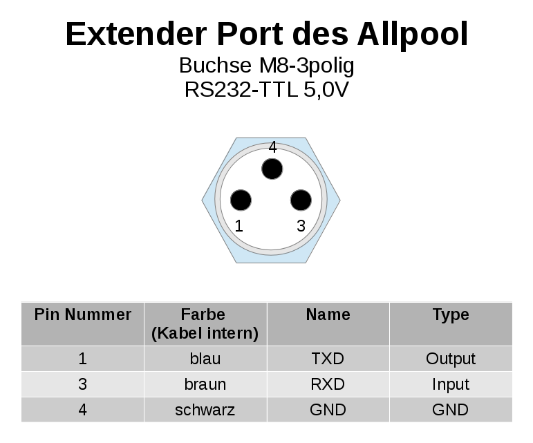
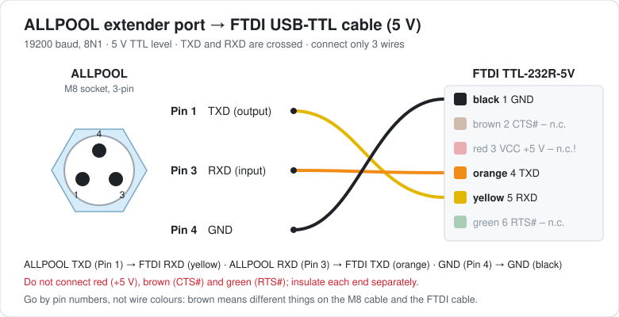

# AllPool-MQTT – PAUSCH ALLPOOL ↔ Home Assistant

**English** | [Deutsch](README.de.md)

A bridge for the Raspberry Pi: it reads the PAUSCH ALLPOOL pool controller via
the ASCII protocol on its extender port (USB serial, 19200 8N1), publishes the
values to Home Assistant via MQTT and executes commands sent from Home
Assistant. Home Assistant discovers the device automatically (MQTT discovery),
so no YAML configuration is needed there.

> Entity names in Home Assistant are in German (e.g. "Filter Modus",
> "Badtemperatur"), matching the ALLPOOL menus. You can rename them in Home
> Assistant or via `name:` in the `values:` section of `config.yaml`.

## Features

- **All values from the PAUSCH protocol table** (firmware 4.1), plus some IDs
  from the menu structure (firmware 4.2.13: holiday dates, statistics, pool
  filling). The menu-structure values are disabled by default because PAUSCH
  does not document their format.
- **Writing from Home Assistant**: operating modes (filter, solar, heating,
  backwash, whirlpool, system, refill) as select entities, set points as
  numbers, universal outputs as switches, holiday start and end as text.
  Values are validated **before** sending (range, step, date). Min/max of the
  set points are read from the ALLPOOL at start-up (`?l`/`?h`).
- **One queue with priority for commands**: only one thread talks to the
  serial port. Commands from Home Assistant jump ahead of all waiting polls and
  are sent right after the poll currently running. Commands among themselves
  and polls among themselves keep their order (FIFO). A value already waiting
  to be polled is not queued twice.
- **Feedback to Home Assistant** when a command cannot be sent immediately
  ("waiting for 2 previous commands (position 3)" or "waiting, connection
  lost"), followed by "executed and confirmed", "rejected by the ALLPOOL: …" or
  "discarded". All of this appears in the sensor **Letzte Meldung** (last
  message) and on the event topic. The messages themselves are in German.
- **Read-back after every write**: right after each write command the value is
  read back from the ALLPOOL (before any other poll). Only this read-back value
  is sent to Home Assistant. If it differs from the value that was set, a
  warning is issued. After a rejected command the value is read back as well,
  so Home Assistant shows the real value again.
- **Poll interval per value, adjustable in Home Assistant** (configuration
  entity "Abfrageintervall …"). Only sensible values are accepted:
  - `0` = only at start-up or on "Alle Werte aktualisieren" (refresh all)
  - otherwise `min_interval` … `max_interval` (default 5 s … 24 h)
  - A value is also rejected if the **estimated load** of the serial port
    caused by polling would exceed `max_bus_load` (default 50 %). The estimate
    uses the ALLPOOL's actually measured response time.
  - When rejected, the value in Home Assistant jumps back and "Letzte Meldung"
    explains why.
  - Intervals are stored and survive a restart.
- **Self-learning speed**: the program measures the ALLPOOL's response time
  and learns the shortest gap between a response and the next command at which
  the device still answers reliably. If a request fails (no or corrupt
  response), it is retried automatically with a larger gap. After many
  successes in a row, the gap is carefully shortened again, but never below
  the value that failed last. The learned value is stored and used immediately
  on the next start. To make sure a late response is never assigned to the
  wrong value, the program waits for the full timeout after a failure and
  clears the receive buffer. Home Assistant shows **Sendeabstand** (gap),
  **Antwortzeit ALLPOOL** (response time) and **Wiederholungen** (retries)
  under *Diagnostic*.
- **Robust**: checksums (XOR as specified by PAUSCH), retries, automatic
  reconnect to MQTT and the serial port. If the ALLPOOL stops answering (power
  off, cable unplugged), the connection is reported as lost and the entities
  become "unavailable" in Home Assistant. Waiting commands are kept until
  `command_timeout` and executed after reconnecting.
- Faulty temperature sensors (ALLPOOL answers `Xl`/`Xh`) show up as "unknown";
  the reason is in the attributes.

## Hardware: connecting the ALLPOOL to the Raspberry Pi

On its right side the ALLPOOL has the **extender port**, a waterproof 3-pin
**M8 socket**. It provides a serial interface with **5 V TTL levels** (not
real RS232 with ±12 V). The easiest way to connect it is an **FTDI USB-TTL
cable, 5 V version (TTL-232R-5V)** plus an M8 cable with plug. Ready-made
solutions from PAUSCH are the **M8USB** cable (direct USB) and the **M8RS232**
interface (real RS232 on DSUB-9).

### Extender port pinout



| Pin | Name | Direction (seen from ALLPOOL) | Wire colour in the cable used |
|---|---|---|---|
| 1 | TXD | output | blue |
| 3 | RXD | input | brown |
| 4 | GND | ground | black |

> **Careful with wire colours:** the colours in the table apply to the cable
> used here. With standard M8 sensor cables it is often the other way round
> (pin 1 = brown, pin 3 = blue, pin 4 = black). Go by the **pin numbers** and
> check your cable with a continuity tester first.

### FTDI cable TTL-232R-5V

| Connector pin | Colour | Signal | Connect? |
|---|---|---|---|
| 1 | black | GND | **yes** → ALLPOOL pin 4 |
| 2 | brown | CTS# | no |
| 3 | red | VCC (+5 V from USB) | **no!** |
| 4 | orange | TXD (output) | **yes** → ALLPOOL pin 3 (RXD) |
| 5 | yellow | RXD (input) | **yes** → ALLPOOL pin 1 (TXD) |
| 6 | green | RTS# | no |

Datasheet: [FTDI TTL-232R cables](https://ftdichip.com/wp-content/uploads/2023/07/DS_TTL-232R_CABLES.pdf)
· [Product page TTL-232R-5V](https://ftdichip.com/products/ttl-232r-5v/)

### Wiring



- **TXD and RXD are crossed**: what the ALLPOOL transmits (TXD) must be
  received by the FTDI cable (RXD), and vice versa.
- **Do not connect red (+5 V).** The ALLPOOL has its own power supply.
  Insulate the unused wires (red, brown, green) separately.
- Other USB-TTL adapters (CH340, CP2102, PL2303) work too, as long as they use
  **5 V levels**. A 3.3 V adapter or an RS232 adapter with a DSUB-9 plug is
  **not** suitable and may damage the interface.

### Checking on the Raspberry Pi

After plugging in, the cable should be detected:

```bash
dmesg | grep -i -E "ftdi|ttyUSB"     # e.g. "FTDI USB Serial Device converter now attached to ttyUSB0"
ls -l /dev/serial/by-id/              # e.g. usb-FTDI_TTL232R_FTxxxxxx-if00-port0 -> ../../ttyUSB0
```

Put the path from `/dev/serial/by-id/` into `config.yaml` as `serial.port`.
It stays the same even if more USB devices are added later. If
`allpool-mqtt --dump` gets no response, TXD and RXD are usually swapped.

## Installation on the Raspberry Pi

Requirements: Raspberry Pi OS (or another Debian-based Linux) with network
access; the USB serial adapter is connected to the Pi and to the ALLPOOL's
extender port.

Log in to the Pi via SSH and run:

```bash
sudo apt update && sudo apt install -y git
git clone https://github.com/mkropa/allpool-mqtt.git
cd allpool-mqtt
sudo ./install.sh
sudo nano /etc/allpool-mqtt/config.yaml     # MQTT broker, user, password, serial port
```

`install.sh` creates a system user `allpool`, installs the program to
`/opt/allpool-mqtt` (with its own Python environment), copies the example
configuration to `/etc/allpool-mqtt/config.yaml` and sets up the systemd
service `allpool-mqtt`. The downloaded folder `~/allpool-mqtt` is then only
used as the source for updates.

Before the first start, a direct test without MQTT is worthwhile:

```bash
ls -l /dev/serial/by-id/             # path of the USB serial adapter
sudo allpool-mqtt --dump             # reads all active values once
sudo allpool-mqtt --dump-all         # also disabled ones (shows what your firmware supports)
sudo allpool-mqtt --raw "42020?h"    # single raw command
```

Then start the service:

```bash
sudo systemctl start allpool-mqtt
journalctl -u allpool-mqtt -f
```

No `systemctl enable` is needed, `install.sh` has already done that: from now
on the service starts automatically at every boot. You can check this with
`systemctl is-enabled allpool-mqtt` (output: `enabled`).

> `--dump` and `--raw` open the serial port themselves. If the service is
> already running, stop it first with `sudo systemctl stop allpool-mqtt`.

### Update

```bash
cd ~/allpool-mqtt
git pull
sudo ./install.sh
```

`install.sh` detects the existing installation, updates the program and Python
packages and restarts the service. Your `/etc/allpool-mqtt/config.yaml` and
the learned values (poll intervals, gap) are kept. New settings from later
versions are listed in `config.example.yaml`; without an entry in your
`config.yaml` the defaults apply automatically.

### Uninstall

```bash
sudo systemctl disable --now allpool-mqtt
sudo rm -rf /opt/allpool-mqtt /etc/allpool-mqtt /var/lib/allpool-mqtt \
            /etc/systemd/system/allpool-mqtt.service /usr/local/bin/allpool-mqtt
sudo systemctl daemon-reload
sudo userdel allpool
```

Afterwards remove the entities in Home Assistant via *Settings → Devices &
services → MQTT → AllPool → Delete*.

## Home Assistant

1. Set up the MQTT broker if you don't have one yet: install the **Mosquitto
   broker** app and add the **MQTT** integration.
2. Create a dedicated MQTT user for the bridge (see below) and enter it in
   `/etc/allpool-mqtt/config.yaml` under `mqtt:`.
3. Start or restart the service (`sudo systemctl restart allpool-mqtt`). The
   log (`journalctl -u allpool-mqtt -f`) should show "MQTT verbunden" (MQTT
   connected). The device **AllPool** with all its entities then appears under
   *Settings → Devices & services → MQTT*.
4. If you previously used another integration that accesses the serial port
   (e.g. a command_line/SSH integration), remove it so that no two programs
   use the port at the same time.

### Dedicated MQTT user for the bridge

Mosquitto supports any number of users. A separate login just for the ALLPOOL
is a good idea; existing users stay unchanged.

**Recommended: a login in the Mosquitto app.** This is a pure MQTT login
that cannot be used to sign in to Home Assistant.

1. *Settings → Apps → Mosquitto broker → Configuration → Edit in YAML*
   (via the three-dot menu ⋮ of the options).
2. Add a new entry with `username` and `password` to the `logins:` section.
   Existing entries stay as they are. With one existing user the whole section
   looks like this, for example:
   ```yaml
   logins:
     - username: myexistinguser
       password: ItsCurrentPassword
     - username: allpool
       password: ALongPassword
   ```
   If there were no logins so far (`logins: []`), replace that line with:
   ```yaml
   logins:
     - username: allpool
       password: ALongPassword
   ```
   Indentation matters: `- username` is indented by two spaces, `password`
   lines up exactly below `username`. The other lines of the configuration
   (`require_certificate`, `certfile`, `customize` …) stay unchanged.
3. **Save** and **restart** the app.
4. Enter user and password in `/etc/allpool-mqtt/config.yaml`:
   ```yaml
   mqtt:
     username: allpool
     password: ALongPassword
   ```

Alternatively, Mosquitto also accepts any Home Assistant user (*Settings →
People → Users*). That user could then also sign in to the Home Assistant UI,
which a device does not need.

The names `homeassistant` and `addons` are reserved by the app and must
not be used.

### Where to find what

The poll intervals are on the device page under **Configuration**; queue,
load and connection status are under **Diagnostic**.

### Notification on problems (example automation)

```yaml
alias: AllPool messages
triggers:
  - trigger: mqtt
    topic: allpool/bridge/event
conditions:
  - condition: template
    value_template: "{{ trigger.payload_json.level in ['warning', 'error'] }}"
actions:
  - action: notify.notify
    data:
      title: AllPool
      message: "{{ trigger.payload_json.message }}"
```

## MQTT topics

| Topic | Direction | Content |
|---|---|---|
| `allpool/<value>/state` | → HA | current value (retained) |
| `allpool/<value>/attributes` | → HA | `{"allpool_id", "raw", "error", "last_update"}` |
| `allpool/<value>/set` | ← HA | new value (e.g. `Auto`, `27.5`, `ON`, `24.12.26`) |
| `allpool/<value>/interval` | → HA | poll interval in s |
| `allpool/<value>/interval/set` | ← HA | new interval |
| `allpool/bridge/availability` | → HA | `online` / `offline` (bridge running) |
| `allpool/bridge/serial` | → HA | `online` / `offline` (ALLPOOL answering) |
| `allpool/bridge/queue` | → HA | entries in the queue |
| `allpool/bridge/load` | → HA | estimated load caused by polling in % |
| `allpool/bridge/timing` | → HA | `{gap_ms, learned_gap_ms, timeout_ms, latency_ms, requests, retries, …}` |
| `allpool/bridge/last_message` | → HA | last message (text) |
| `allpool/bridge/event` | → HA | every message as JSON `{level, message, key, status, position, …}` |
| `allpool/bridge/refresh` | ← HA | read all values now |
| `allpool/raw/request` | ← | raw command: `2010?`, `42020?h` or `{"id": 36020}` |
| `allpool/raw/response` | → | its response |

Writing raw commands (`{"id": 42020, "value": "27.0"}`) only works with
`allow_raw_write: true`.

## Values

`allpool-mqtt --list` shows the table with key, ID, type, default interval and
whether the value is active. In `config.yaml` under `values:` you can enable or
disable each value, rename it or add your own IDs.

Operating modes (alternatives as defined by PAUSCH, starting at 1):

| ID | Value | 1 | 2 | 3 |
|---|---|---|---|---|
| 30010 | System | Auto | Aus (off) | – |
| 33010 | Filter | Auto | Aus (off) | Hand (on) |
| 33011 | Whirlpool | Auto | Aus (off) | Hand (on) |
| 39010 | Backwash | Auto | Aus (off) | Start |
| 42010 | Heating | Auto | Aus (off) | Hand (on) |
| 45010 | Solar | Auto | Aus (off) | Hand (on) |
| 48010 | Refill | Nein (no) | Ja (yes) | – |

The option labels in Home Assistant are the German ones shown above.

## Notes on individual values

- **1100 backwash state**: PAUSCH writes "Bits: 0=filtering …", but the range
  is 0–3. The number is therefore shown as a state (0 = Filtern, 1 =
  Nachspülen, 2 = Entleeren, 3 = Rückspülen). Other numbers are shown raw.
- **30030 / 30031**: according to the protocol table "min./max. pool
  temperature during holidays", according to the menu structure "heat
  conventionally up to" / "heat with solar up to" during holidays. The names
  from the menu structure are used.
- **Universal outputs** can only be switched if they are set to *Funktion /
  Händisch* (manual) on the ALLPOOL. Otherwise a clear error message is shown.
- **Values from the menu structure** (statistics, 48020 pool filling): check
  once with `allpool-mqtt --dump-all` what your firmware returns, then enable
  them selectively.

## Testing without an ALLPOOL

`tools/allpool_simulator.py` creates a virtual serial port that emulates the
protocol including checksums and error codes:

```bash
python3 tools/allpool_simulator.py --link /tmp/allpool-sim &
# --min-gap 0.08: ignores commands arriving < 80 ms after the last response
#                 (slow ALLPOOL, for testing the learning function)
# --quirks: whirlpool mode confirms writes but keeps the old value
#           (for testing the read-back check)
# in config.yaml:  serial: {port: /tmp/allpool-sim}
kill -USR1 %1     # simulator stops / resumes answering ("power off")
```
